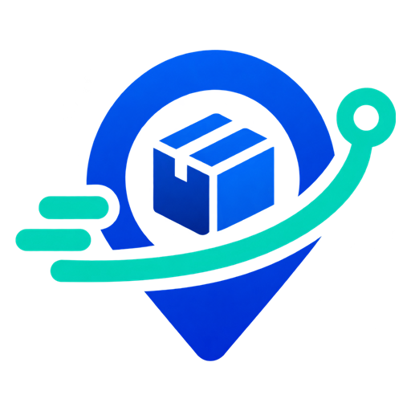

<div align="center">



# Traylo

**Gerenciamento de entregas e acompanhamento de pedidos em tempo real.**

Cliente, entregador e administrador em um só sistema — com mapa estilo GPS, rotas e indicadores logísticos.

</div>

---

## Sobre o projeto

O Traylo nasceu do trabalho de **Gerência de Projetos** da disciplina **Processo de Software** (UNISINOS, prof. Dr. Roberto Zanoni): o planejamento de um sistema digital de gerenciamento de entregas e acompanhamento de pedidos para uma empresa de médio porte do varejo online.

Este repositório reúne o **protótipo funcional** do sistema (correspondente às voltas 1 a 4 do modelo Espiral) e a **documentação de gestão do projeto** em [`docs/gerenciamento-do-projeto.md`](docs/gerenciamento-do-projeto.md).

**Equipe:** Arthur C., Matheus, Richard, Lorenzo B. e Lorenzo P. — São Leopoldo, novembro de 2026.

## Perfis de usuário

| Perfil | O que faz no Traylo |
| --- | --- |
| **Cliente** | Faz pedidos, acompanha o status em tempo real no mapa, recebe avisos por app e e-mail, exerce seus direitos da LGPD (exportar/excluir dados). |
| **Entregador** | Recebe rota otimizada, navega curva a curva, atualiza o status com poucos toques e trabalha mesmo sem sinal (modo offline com sincronização). |
| **Administrador** | Despacha entregas, acompanha o mapa ao vivo e os indicadores (no prazo, atrasos, cancelamentos), gerencia usuários e consulta a trilha de auditoria. |

## Funcionalidades do protótipo

- Rastreamento de pedidos com linha do tempo e mapa (MapLibre + rotas por vias reais via OSRM).
- Navegação do entregador com banner de manobras em português, ETA e câmera 3D.
- Atribuição de entrega **atômica** (compare-and-set): uma entrega nunca tem dois responsáveis.
- Modo offline do entregador: ações ficam em fila local com data e hora e sincronizam ao voltar o sinal.
- Notificações com fila, nova tentativa e canal alternativo (e-mail se o push falhar).
- Painel de indicadores com definições formais e trilha de auditoria.
- Controle de acesso por perfil validado na "camada de servidor", 2FA para administradores e expiração de sessão por inatividade.
- Tema claro/escuro automático (dark em preto puro).

> **Importante:** é um protótipo. Não há back-end real: os dados ficam no `localStorage` do navegador, e a posição do entregador é simulada. Serviços de mapas/rotas públicos são usados apenas para demonstração.

## Como os riscos do projeto aparecem no código

O trabalho identificou dez riscos com plano de mitigação. O protótipo já exercita vários deles:

| Risco | Onde está no protótipo |
| --- | --- |
| R2 — Acesso indevido entre perfis | `src/lib/api.ts`: cada operação valida perfil e dono do recurso; 2FA do admin; sessão com expiração |
| R3 — Status inconsistente | Fonte única de verdade; cada mudança vira evento com data e hora |
| R4 — Conflito de atribuição | `api.assign` faz compare-and-set |
| R5 — Entregador sem conexão | Modo offline com cache da rota e fila de sincronização |
| R6 — Falha de notificação | Fila com tentativas, canal alternativo e reprocessamento pelo admin |
| R8 — Indicadores errados | Definições formais no painel e cálculo centralizado (`kpis`) |
| R1 — Dados pessoais (LGPD) | Coleta mínima, consentimento, exportação e exclusão (anonimização) de dados |

A lista completa (R1–R10) está na [documentação](docs/gerenciamento-do-projeto.md#4-análise-de-riscos-e-segurança).

## Stack

React 18 · TypeScript · Vite · Tailwind CSS · shadcn/ui (estrutura `components/ui`) · Framer Motion · Lucide · MapLibre GL

## Como rodar

Requer [Node.js](https://nodejs.org) 18+.

```bash
npm install
npm run dev
```

Abra http://localhost:5173. Build de produção: `npm run build`.

### Contas de demonstração

Senha de todas: `1234`.

| Perfil | E-mail |
| --- | --- |
| Cliente | `cliente@traylo.app` |
| Entregador | `entregador@traylo.app` |
| Administrador | `admin@traylo.app` (código 2FA: `000000`) |

Dica: abra uma aba por perfil — as mudanças aparecem nas outras abas em tempo real.

## Estrutura

```
src/
  lib/          # api (servidor simulado), geo, roteamento, hooks
  components/   # GpsMap, Logo, PhoneShell e components/ui (shadcn)
  views/        # Login, Customer, Courier, Admin
docs/           # documentação de gestão do projeto
legacy/         # primeiro protótipo (HTML/JS puro)
```

## Roadmap (voltas do Espiral)

| Volta | Foco | Semanas |
| --- | --- | --- |
| 1 | Requisitos, viabilidade e protótipo de telas | 3 |
| 2 | Rastreamento de pedidos e notificações | 5 |
| 3 | Rotas otimizadas e app do entregador | 5 |
| 4 | Relatórios e endurecimento de segurança | 4 |
| 5 | Implantação, treinamento e suporte | 3 |

Próximos passos técnicos: back-end real com banco de dados, GPS real no app do entregador, integração com ERP/transportadoras e gateway de pagamento certificado (PCI DSS).

## Licença

Projeto acadêmico. Todos os direitos reservados à equipe.
